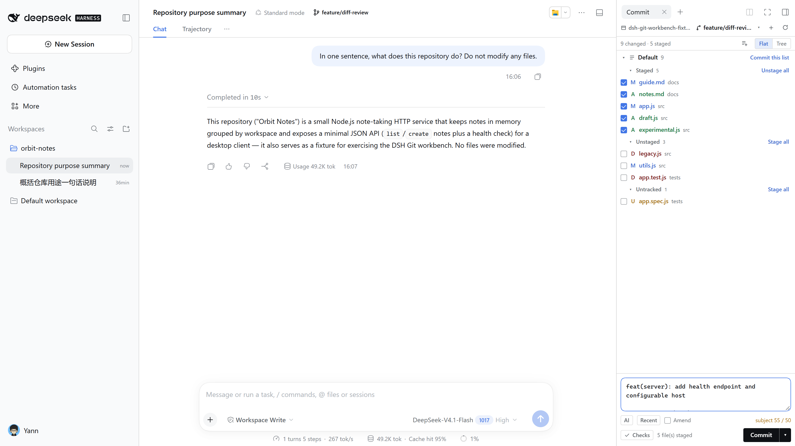
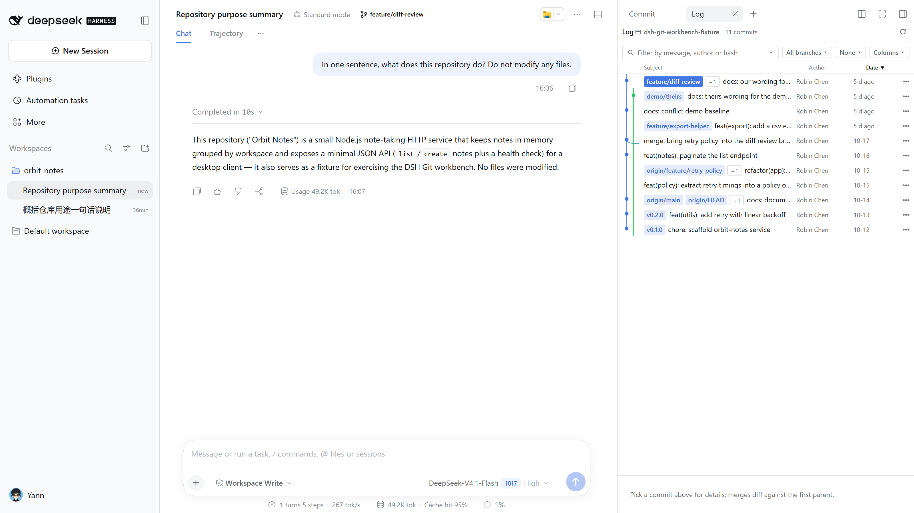
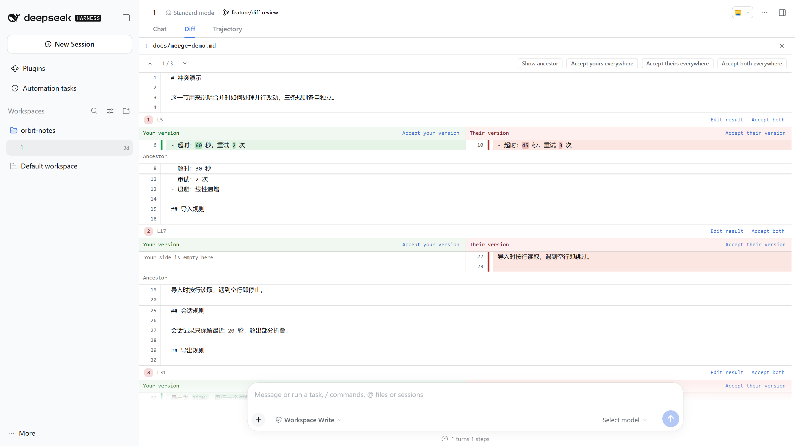
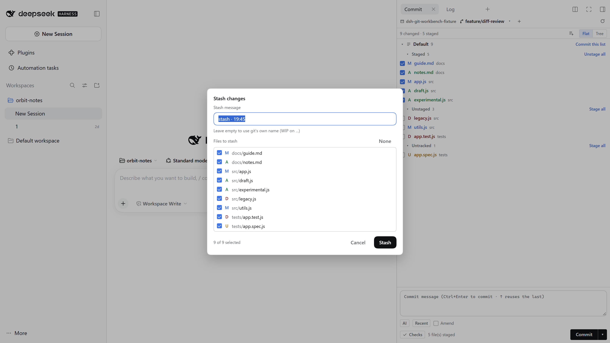

# dsh-git-workbench

**A JetBrains-style Git workbench for DeepSeek Harness.** Local Changes tree, hunk- and line-level staging, side-by-side diff, commit window, commit graph, annotate, interactive rebase, shelve, three-way conflict resolution — all next to the conversation, no terminal switching.

> The goal is not "being able to commit", but seeing **which line changed, which hunk gets staged, and which branch the commit lands on** as clearly as in IDEA.

[](https://www.npmjs.com/package/@yann9/dsh-git-workbench)
[](https://www.npmjs.com/package/@yann9/dsh-git-workbench)
[](https://github.com/yann9/dsh-git-workbench/actions/workflows/ci.yml)
[](package.json)
[](#install)
[](LICENSE)

[中文](README.zh.md) · [Features](docs/features.md) · [HTTP API](docs/api.md) · [Architecture](docs/architecture.md) · [Design notes](docs/jetbrains-parity.md) · [Development](docs/development.md)



## What it is

DSH's right sidebar is a draggable tab area, which maps to IDE tool windows; the diff opens in the main area like an editor tab and is a **singleton** — opening another file replaces the content instead of stacking tabs.

| JetBrains | Here | Contents |
|---|---|---|
| Commit tool window | **Commit** tab | changes tree + changelists + conflicts + message + `AI` / `Recent` / `Checks` / `Amend` |
| Log tool window | **History** tab | commit graph + commit details + file list, read-only |
| Editor diff tab | **Diff** view (main area) | side-by-side / unified, hunk & line staging, annotate, conflict view |

Commit and history keep their own selection, scroll, filters and draft; the diff decides what it shows and whether it is writable from its `source` (`working` = writable, `commit` / `turn` = read-only).

It also plugs into DSH surfaces you already use: the branch chip in the session header, the branch picker in the new-session hero, the `Git` buttons on turn cards and the Files tab, and the change bar above the composer. The repository follows the session cwd — switching sessions switches repositories.

## Screenshots

| Diff (side-by-side, word-level) | History (graph + sortable table) |
|---|---|
|  |  |
| **Conflict resolution** | **Stash (name + partial files)** |
|  |  |

The Chinese-UI set is the same files without the `-en` infix, used by [README.zh.md](README.zh.md). The workbench follows the host theme and has no theme switch of its own, so dark mode needs no separate set.

## Install

Requires `git` on `PATH`, Node `^22.19.0 || >=24.0.0`, `pnpm`, and DSH `0.2.1-rc.2` or newer.

```bash
# install from npm
dsh plugin --profile web add @yann9/dsh-git-workbench

# or from a local checkout (link: symlinks, file: copies)
dsh plugin --profile web add link:<absolute path to this repo>

# the bundle layer is read at startup only
dsh web
```

Open the `?token=...` URL printed by the server. The **Commit** and **History** tabs are available from the sidebar's `+` guide page, and the branch chip in the session header works out of the box.

If the profile does not register the bundle automatically (occasionally happens with `link:` / `file:` installs), add `"@yann9/dsh-git-workbench"` to `dsh.profile.bundles` in `~/.dsh/profiles/web/package.json`.

**Upgrade and remove** (also needs a `dsh web` restart):

```bash
dsh plugin --profile web add @yann9/dsh-git-workbench@latest
dsh plugin --profile web remove @yann9/dsh-git-workbench
```

`/dsh-git/` serves JSON API and SSE only — there is no standalone page. See [docs/api.md](docs/api.md).

## Configuration

Everything is editable in **Settings → Plugins → Git workbench**, or in the profile's `cordis.patch.yml`:

```yaml
- insert:
    - id: git-workbench
      name: '@yann9/dsh-git-workbench'
      config:
        repoPath: ''                   # fallback repo when there is no session cwd
        maxLog: 400
        readOnly: false                # true = every write API returns 403
        branchPattern: 'session/{date}-{time}'
        confirmDirtySwitch: true
        diffFullFile: true
        diffWrap: true
        diffFoldThreshold: 8
        diffSideBySide: true
        listMode: 'last'               # 'tree' | 'flat' | 'last'
        commitLanguage: 'auto'         # 'auto' | 'zh' | 'en'
        llmProvider: ''
        llmModel: ''
```

## Highlights

- **Staging** — whole file, hunk (cropped patch → `git apply --cached`), or individual lines; unstaging is equally precise. Commits always use the index.
- **Reading diffs** — side-by-side / unified, dual line numbers, word-level highlights, ignore-whitespace (read-only), context folding, `‹ n/m ›` file navigation and `F7` hunk navigation.
- **Committing** — `Ctrl+Enter`, AI draft, `↑` to recall previous messages, amend, changelists, and before-commit checks taken from the repo's own `package.json` scripts.
- **History** — DAG graph, sortable columns, group by branch/author/date, structured filters (`author:` `message:` `hash:` `tag:` `branch:` `date:`), multi-select for batch cherry-pick / revert.
- **Rewriting history** — interactive rebase (pick/squash/fixup/drop), reword, undo commit, cherry-pick, revert, soft/hard reset — all behind explicit confirmations.
- **Branches & remotes** — switch/create/rename, `↑N ↓N` ahead-behind badges, set/unset upstream, compare, rebase onto, fetch/pull/push (Pick a remote on first push), manage remotes.
- **Conflicts & sequencer** — separate unmerged group, three-way view with per-block choices or a hand-written merged result, status bar with continue/abort while a merge, cherry-pick or rebase is paused.
- **Stash** — name + select files (partial stash uses a temporary index so unrelated staged content is untouched), read-only preview, apply/pop/drop.
- **Git console** — every real argv, exit code, duration and output per repository; failures expand automatically.
- **Empty directory** — one-click `git init` without touching existing files.
- **Bilingual** — follows DSH's language preference (falling back to the browser language) and switches live; git's English refusals are localized rather than dumped into the UI.

The full 50+ item comparison against JetBrains is in [docs/features.md](docs/features.md); keyboard shortcuts are in the [Chinese README](README.zh.md#快捷键).

## Development

```bash
npm test                     # 104 tests against real git repositories

node scripts/dev-server.js <repo> 5178   # API only, no UI
```

No build step: host and client are plain ESM, so `link:` + restart is the whole loop. See [docs/development.md](docs/development.md).

## Security

Every git call is `spawn('git', argv)` with **no shell**; writes are serialized; paths are validated against `..` and option injection; cross-origin requests are rejected; `readOnly: true` blocks all writes; no credentials are ever collected and network operations never prompt (120 s timeout, `GIT_TERMINAL_PROMPT=0`). Details: [docs/architecture.md](docs/architecture.md#安全模型).

## Versioning

semver, with `package.json`, the [CHANGELOG.md](CHANGELOG.md) heading and the git tag (`v0.1.0`) always kept in sync. CI runs the test suite on Ubuntu and Windows across Node 22 / 24 — four jobs, all green before a merge.

Pushing a tag *is* the release: `.github/workflows/release.yml` gates on the same matrix, creates the GitHub Release with notes grouped by conventional commit type, publishes to npm through Trusted Publishing (OIDC — no token in the repository) and then re-installs the published tarball to verify its payload. See [docs/development.md](docs/development.md) for the workflow and the Trusted Publisher binding.

## License

[MIT](LICENSE)
