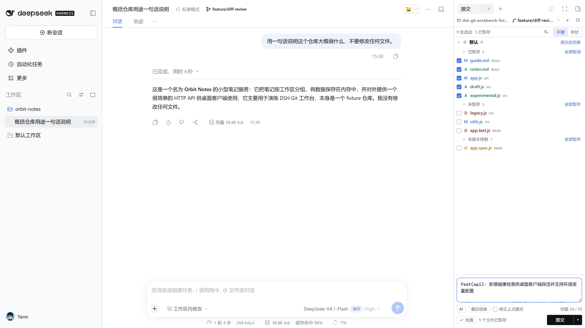
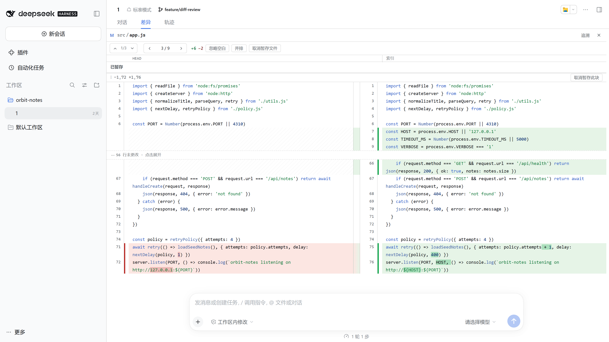
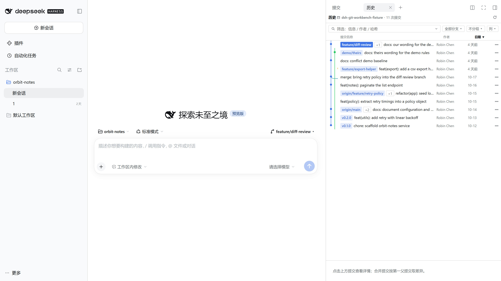
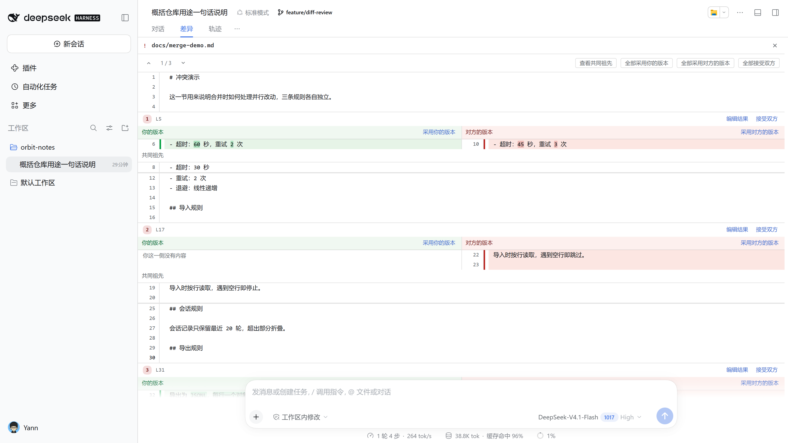
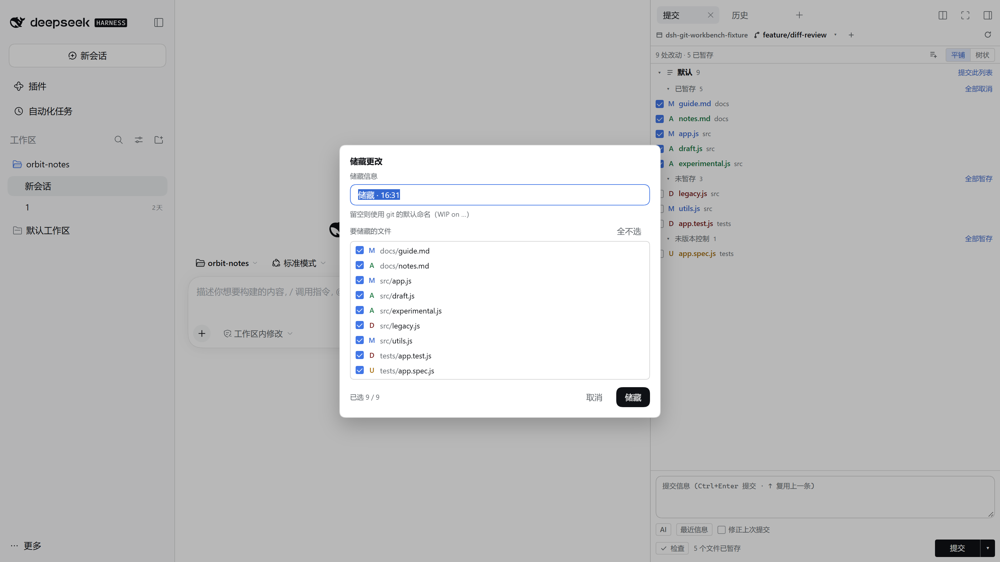

# dsh-git-workbench

**JetBrains 式的 Git 工作台，跑在 DeepSeek Harness 里。** Local Changes 树、逐 Hunk / 逐行暂存、并排 Diff、Commit 窗口、提交图、Annotate、交互式变基、储藏、冲突三方视图 —— 全部留在会话旁边，不用切终端。

> 目标不是"能提交"，而是"改哪一行、暂存哪一段、提交进哪个分支"都能像在 IDEA 里一样看得见。

[](https://www.npmjs.com/package/@yann9/dsh-git-workbench)
[](https://www.npmjs.com/package/@yann9/dsh-git-workbench)
[](https://github.com/yann9/dsh-git-workbench/actions/workflows/ci.yml)
[](package.json)
[](#安装)
[](LICENSE)

[English](README.md) · [中文](README.zh.md) · [功能清单](docs/features.md) · [HTTP API](docs/api.md) · [架构](docs/architecture.md) · [设计取舍](docs/jetbrains-parity.md) · [开发与发布](docs/development.md)



---

## 是什么

DSH 的右侧栏是可拖动的页签区（能拖到别的面板、拆成第二栏、浮动、全屏），正好对应 IDE 的两个工具窗口；diff 则和 IDEA 一样开在编辑器位置、只有一块。于是插件就是三个彼此独立的界面：

| JetBrains | 这里 | 内容 |
|---|---|---|
| Commit 工具窗口 | 页签 **提交** | 变更树 + 变更列表 + 冲突 + 提交信息 + `AI` / `最近信息` / `检查` / `Amend` |
| Log 工具窗口 | 页签 **历史** | 提交图 + 提交详情 + 文件清单，只读 |
| 编辑器里的 diff tab | **主区域** 差异视图 | 并排 / 统一 diff、块级与行级暂存、Annotate、冲突三方视图，单例、每次替换 |

提交与历史各有自己的勾选、滚动、过滤和草稿，互不干扰；差异视图由"来源"决定内容与可写性——从「提交」进来是工作区（可写），从「历史」或会话轮次进来是只读快照。

此外它还接进了 DSH 自己的几个 surface：会话头部的分支芯片、新会话空状态的分支选择器、会话卡片的 `Git` 按钮、右侧「文件」页的 `Git` 按钮、输入框上方的改动条。仓库绑定会话的 cwd，切换会话就切换仓库。

## 截图

| 差异视图（并排、行内词级高亮） | 历史页（提交图 + 表头排序） |
|---|---|
|  |  |
| **冲突三方视图** | **储藏（命名 + 部分文件）** |
|  |  |

深色主题完全跟随宿主，没有自己的主题开关：以上四张的深色版本在 [docs/assets](docs/assets) 里同目录（`*-dark.png`）。

## 安装

插件以目录形式安装到 DSH 的 web profile。**先在 PATH 上准备好** `git`、Node `^22.19.0 || >=24.0.0`、`pnpm`（`dsh plugin` 转发给它）以及 DSH `0.2.1-rc.2` 以上。

```bash
# 从 npm 安装
dsh plugin --profile web add @yann9/dsh-git-workbench

# 或让 DSH 从本地目录安装（file: 复制内容；link: 建符号链接）
dsh plugin --profile web add link:<仓库目录的绝对路径>

# bundle 层只在启动时读取，重启后生效
dsh web
```

打开终端打印的 `?token=...` 地址。右侧栏 `+` 的引导页里能看到并打开「Git 提交与暂存」「Git 历史」，会话头部的分支芯片、设置 → 插件 → Git 工作台也直接可用。

`file:` 安装是复制，改完代码要重新 `add`；开发期用 `link:`，改完重启一次即可（代价是要自己维护下面这行 bundle 登记）。

**如果 profile 里没有自动登记 bundle**（DSH 0.2.1-rc.2 用 `link:` / `file:` 安装时偶发），在 `~/.dsh/profiles/web/package.json` 里补一行，效果与 `plugin add` 相同：

```json
"dsh": { "profile": { "bundles": ["@deepseek-ai/dsh-base", "@deepseek-ai/dsh-web-app", "@yann9/dsh-git-workbench"] } }
```

**升级与卸载**（同样要重启 `dsh web`）：

```bash
dsh plugin --profile web add @yann9/dsh-git-workbench@latest
dsh plugin --profile web remove @yann9/dsh-git-workbench
```

`/dsh-git/` 只提供 JSON API 与 SSE 事件流，没有独立页面；任何别的客户端都可以直接复用它（见 [docs/api.md](docs/api.md)）。

## 配置

全部配置项都能在 **设置 → 插件 → Git 工作台** 里改（保存后插件自动重载一次），也可以直接写进 profile 的 `cordis.patch.yml` 后重启 `dsh web`：

```yaml
- insert:
    - id: git-workbench
      name: '@yann9/dsh-git-workbench'
      config:
        repoPath: ''                   # 没有任何会话上下文时的兜底仓库
        maxLog: 400                    # 提交图/历史最多取多少条（1–5000）

        readOnly: false                # true = 只读：写接口一律 403，界面不出现写入入口

        branchPattern: 'session/{date}-{time}'   # 新建分支的默认名，占位符 {date} {time} {datetime} {repo}
        confirmDirtySwitch: true       # 工作区有改动时，切分支先确认

        diffFullFile: true             # true = 整文件 + 折叠未变区；false = 只看改动前后 3 行
        diffWrap: true                 # true = 长行软换行；false = 裁切
        diffFoldThreshold: 8           # 未变区超过多少行折叠（2–500）
        diffSideBySide: true           # 首次打开用并排还是统一视图

        listMode: 'last'               # 'tree' | 'flat' | 'last'（跟随上次选择）

        commitLanguage: 'auto'         # 'auto'（跟随界面语言）| 'zh' | 'en'
        llmProvider: ''                # 留空 = 模型路由的默认 provider
        llmModel: ''                   # 留空 = provider 的目录 / 默认模型
```

未写的键使用上表默认值。`readOnly: true` 适合把工作台当作只读评审面板：暂存、提交、分支、网络、冲突解决全部禁用，HTTP 写接口返回 403（`/config` 除外）。

## 主要能力

完整的 50+ 项对照表在 [docs/features.md](docs/features.md)，这里只列骨架：

- **暂存**：整文件 / 逐 Hunk（裁剪 patch → `git apply --cached`）/ 逐行；反向取消暂存同样精确。提交永远以 index 为准。
- **差异阅读**：并排与统一视图、双行号、行内词级高亮、忽略空白（只读保护）、未变区折叠、文件间 `‹ n/m ›` 与块间 `F7`。
- **提交**：Commit 窗口（`Ctrl+Enter`）、AI 草稿与最近信息召回（`↑`）、Amend、变更列表、提交前按仓库 `package.json` 跑检查（失败默认拦截）。
- **历史**：DAG 泳道提交图、表头排序、列开关、按分支/作者/日期归类、结构化筛选（`author:` `message:` `hash:` `tag:` `branch:` `date:`）、多选后批量拣选 / 还原。
- **改写历史**：交互式变基（pick / squash / fixup / drop）、改写提交信息、撤销提交、拣选、还原、软/硬重置，全部二次确认。
- **分支与远程**：切换 / 新建 / 重命名、领先落后 `↑N ↓N`、设置与取消上游、分支比较、变基到所选分支、fetch / pull / push（首次推送让你选远程）、远程仓库增删改。
- **冲突与序列器**：unmerged 独立分组、三方视图逐块选边或手写合并结果、合并 / 拣选 / 变基暂停时的状态条与「继续 / 中止」。
- **储藏**：命名 + 勾选文件（部分储藏走临时 index，不带走别的暂存内容）、只读预览、应用 / 弹出 / 删除。
- **可观测**：Git 控制台按仓库记录每条真实 argv、退出码、耗时与输出，失败自动展开。
- **空目录**：一键 `git init`，不动现有文件。
- **中英双语**：跟随 DSH 的语言偏好（没设置时看浏览器语言），切换即时生效；Git 的英文拒绝会被本地化而不是原样甩给用户。

## 快捷键

| 操作 | 快捷键 / 手势 |
|---|---|
| 刷新 | `F5` |
| 提交 | `Ctrl/Cmd + Enter` |
| 聚焦提交信息 | `Ctrl/Cmd + K` |
| AI 生成提交信息 | `Ctrl/Cmd + G` |
| 上一个 / 下一个文件 | `Alt + ↑` / `Alt + ↓`，或头部 `‹ n/m ›` |
| 上一个 / 下一个差异块 | `Shift + F7` / `F7`，或工具栏 `↑ 差异 ↓`（走到头自动进相邻文件） |
| 还原当前差异块 | `Ctrl/Cmd + Alt + R`（工作区来源，先确认） |
| 当前文件集里挑文件 | 点头部 `3 / 5` |
| 从差异回到会话 | `Esc` 或右上角 ✕ |
| 历史页逐条翻提交 | `↑` / `↓`、`Home` / `End`，`Enter` 或双击打开差异 |
| 历史页多选提交 | `Ctrl/⌘` 点选、`Shift` 连选、`Ctrl+A` 选可见项、`Esc` 清空 |
| 空提交框召回上一条信息 | `↑` / `↓` |
| 暂存选中行 | 点行首 `+`/`−` 选中，再点「暂存选中行」 |

## 文档

| 文档 | 内容 |
|---|---|
| [docs/features.md](docs/features.md) | 与 JetBrains 逐项对照的完整功能表、布局断点、已知限制、路线图 |
| [docs/api.md](docs/api.md) | `/dsh-git/api` 全部端点、参数、缓存与 CSRF 约定，以及给模型的 8 个工具 |
| [docs/architecture.md](docs/architecture.md) | host / client 分层、DSH 槽位、状态同步、多语言、安全模型 |
| [docs/jetbrains-parity.md](docs/jetbrains-parity.md) | 为什么不照抄 JetBrains、为什么不用 iframe、为什么只读是一种渲染路径 |
| [docs/development.md](docs/development.md) | 开发循环、测试、调试服务器、截图约定、发布到 GitHub / npm 的检查清单 |
| [CONTRIBUTING.md](CONTRIBUTING.md) | 提 PR 前要跑的检查与代码约定 |
| [CHANGELOG.md](CHANGELOG.md) | 版本变更记录 |

## 开发

```bash
npm test                     # 104 个单测，使用真实 git 仓库（含 Windows 路径与 CRLF）

# 只跑 API、不带 UI，方便调试或给别的客户端用
node scripts/dev-server.js <仓库路径> 5178
# → http://127.0.0.1:5178/dsh-git/api/...
```

host 与 client 都是可直接运行的 ESM，没有构建步骤：`link:` 指向目录，改代码重启 `dsh web` 即生效。细节见 [docs/development.md](docs/development.md)。

## 安全

- 所有 git 调用都是 `spawn('git', argv)`，**不经过 shell**；用户输入只以白名单校验后的 argv 片段出现。
- 写操作串行化（`withWriteLock`），路径拒绝 `..` 逃逸，commit/ref 只接受合法 revision。
- `Origin` 与 `Host` 不匹配的请求一律 403；请求体上限 2 MB；`/dsh-git/` 下只映射 API。
- `readOnly: true` 时除 `/config` 外的 POST 全部 403。
- 不在浏览器里跑 git、不在页面里收集凭据；网络操作 120 s 超时且 `GIT_TERMINAL_PROMPT=0`，绝不挂起。

完整说明见 [docs/architecture.md#安全模型](docs/architecture.md#安全模型)。

## 版本

semver，且 `package.json` 的 `version`、[CHANGELOG.md](CHANGELOG.md) 的段落标题与 git tag（`v0.1.0`）三处始终一致。CI 在 Ubuntu 与 Windows 上跑 Node 22 / 24 四组矩阵，合并前必须全绿。

推送 tag 就是发布：`.github/workflows/release.yml` 先跑同一套矩阵当闸门，再建 GitHub Release（说明按 conventional commit 的类型分组），然后用 npm 的 Trusted Publishing（OIDC，仓库里没有 token）把包发到 npm 并从官方源回读校验包内容。流程细节与 Trusted Publisher 绑定步骤见 [docs/development.md](docs/development.md)。

## 许可

[MIT](LICENSE)
